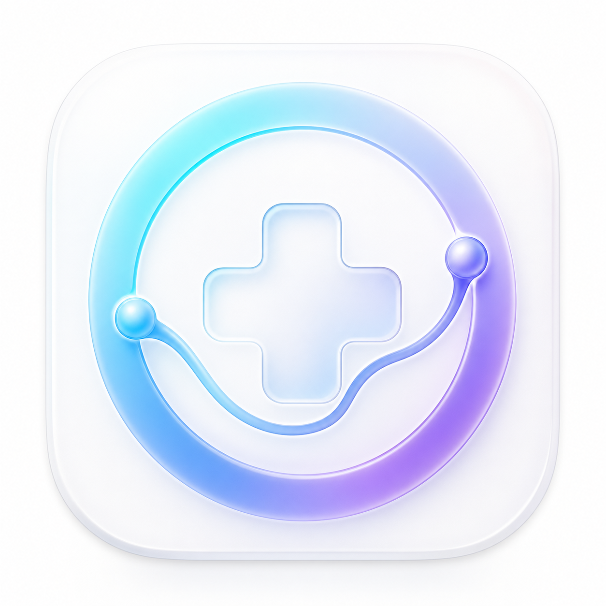
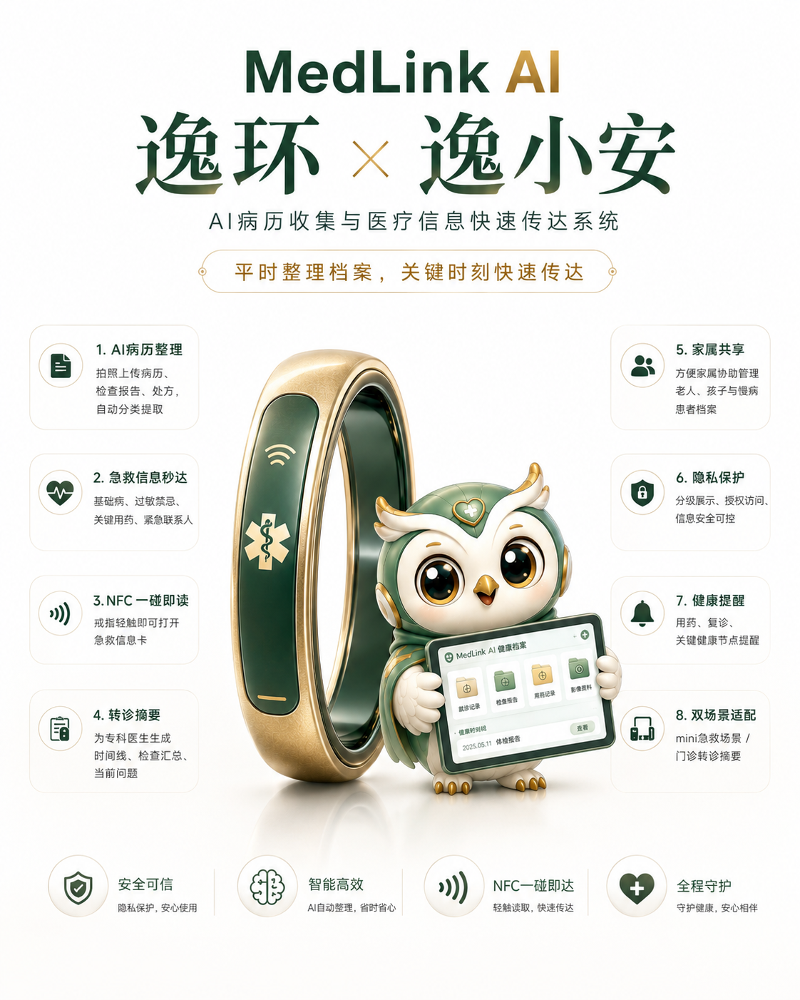
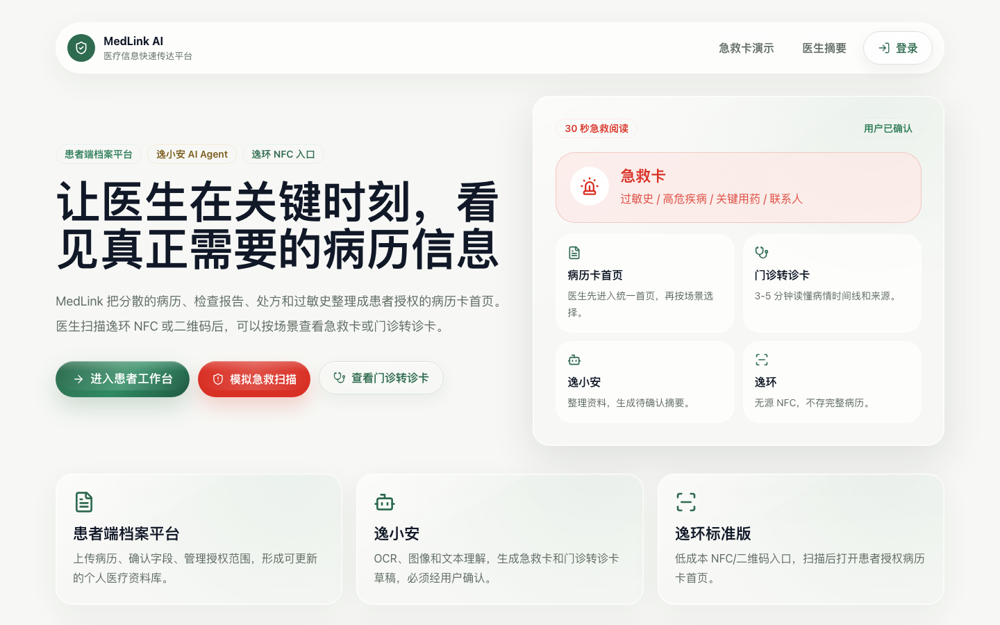
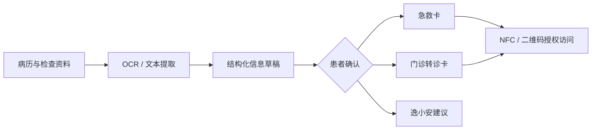

  
  <h1>MedLink AI</h1>
  
<strong>让医生在关键时刻，看见真正需要的病历信息。</strong>

  
Patient-authorized medical summaries for emergency care, follow-up visits and referrals.

  
  
  

[最新演示](#最新演示) · [核心模块](#核心模块)

## 项目简介

MedLink AI 是一个面向急救、门诊复诊、转诊和家庭协助场景的医疗信息快速传达原型。它将分散的病历、检查报告、处方与过敏史整理为患者授权的信息首页，让医生能够按场景快速获取最重要、可追溯的内容。

产品坚持三项原则：**患者确认后发布、按场景最小化展示、原始资料可追溯**。逸环 NFC 或二维码只作为访问入口，不在实体介质中存储完整病历。

## 最新演示

  
  
<strong>平时整理档案，关键时刻快速传达。</strong>

  
<a href="docs/media/medlink-ai-poster.png">查看完整海报</a>

## 网站界面

## 核心模块

| 模块 | 解决的问题 |
| --- | --- |
| 患者端档案平台 | 上传病历、查看提取正文、确认结构化字段并管理授权范围 |
| 逸小安 AI Agent | 根据个人病历生成复诊准备、急救重点和医生摘要待确认建议 |
| mini 急救卡 | 用 30 秒阅读模式呈现过敏史、高危疾病、关键用药和紧急联系人 |
| 门诊转诊卡 / Pro 医生摘要 | 用时间线、检查结果和来源帮助医生快速理解当前问题 |
| 逸环 NFC 管理 | 通过无源 NFC / 二维码打开患者授权的信息入口 |

## 信息流

## 展示范围

本仓库仅包含作品介绍、精选截图、宣传海报与演示视频。项目源码、开发文档和服务端配置不公开。
